# CHERQAiN

**Why?**

CHERQAiN ("Computer Helping Etienne with Research Queries, AI and Notes", formerly named ChatEKLD or PaperMind) is a project I vibe-coded through iterative sessions over the last couple of months in my free time. The idea is to have local (or online) LLMs help me retrieve knowledge from Obsidian `.md` notes, PDFs, or images in my vault, generate first drafts of presentations on various topics using indexed information, and read single papers.

Indexing my vault took a lot of time because I had more than 6,000 PDFs, but it was mainly done overnight and was worth it. Of course, online LLMs seem much better than the local LLMs I use on my MacBook Pro M4 with 16 GB of RAM, but using offline local LLMs is still pretty nice! Some other functions are more for my personal use, e.g., a library function that helps me tag PDFs and rename them.

Don't hesitate to reach out if you have suggestions or appreciate the project.

Below is a more detailed and technical presentation, obviously not written by me but by a friendly LLM.

**Local-First Research Assistant for Obsidian Vaults, PDFs, Zotero Libraries, and Grounded LaTeX / Markdown Authoring**

CHERQAiN is a local Flask and PyWebView desktop application for macOS (Apple Silicon) that combines hybrid RAG over your Obsidian notes and PDFs, single-paper summarisation, Zotero and local-PDF library reconciliation, and vault-grounded LaTeX Beamer / article generation. It runs offline by default with Ollama or LM Studio, and can optionally route chat or explicitly confirmed OCR/vision runs through OpenAI, Anthropic, Google Gemini, DeepSeek, Z.AI (GLM), or OpenRouter while keeping your vector index, embeddings, and notes on-device.

> [!IMPORTANT]
> **Write-Safety Invariant:** Indexing, chat, summaries, and Library scans read source material and write application state only under `~/Library/Application Support/ChatEKLD/` (`CHERQAIN_BASE_DIR`). Your vault notes, Finder tags, and Zotero items are modified **only** when you explicitly select and confirm a write action, and every supported mutation records an audit log and recovery path.

---

## Screenshots

These screenshots show the native CHERQAiN application with local models. Private vault paths are masked. They illustrate workflows and draft output; they do not establish scientific accuracy or native stability.

**Ask** — the opening of a local response grounded in retrieved vault passages. The requested protocol/review/thesis comparison remained incomplete; ten retrieved chunks do not imply ten verified claims.

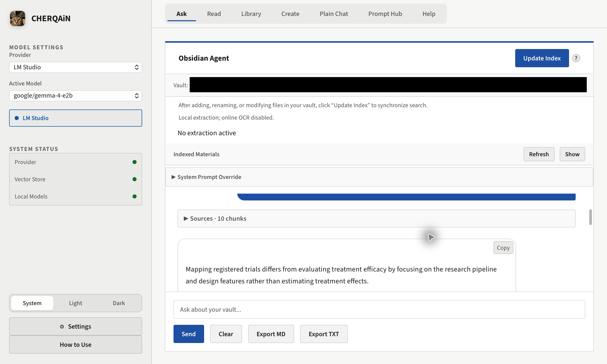

| | |
|:--|:--|
| 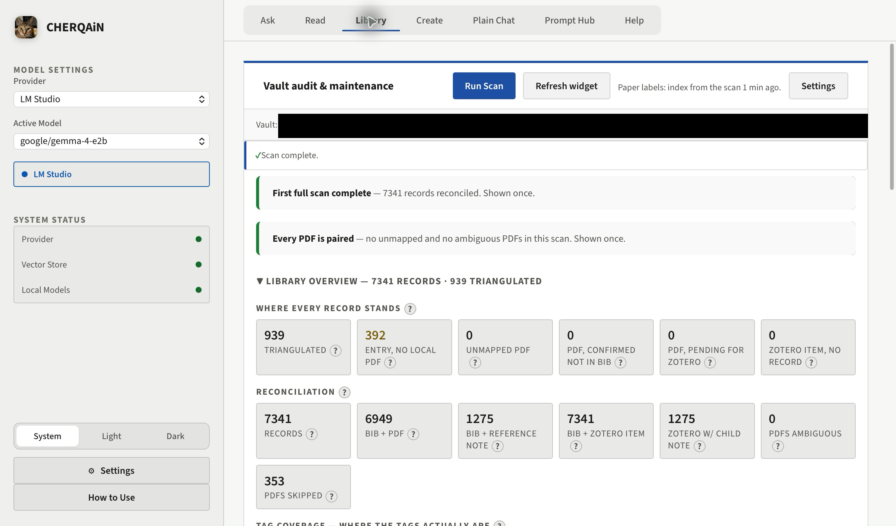<br>**Library** — a completed scan showing library associations, not reading progress or a completed index update. | 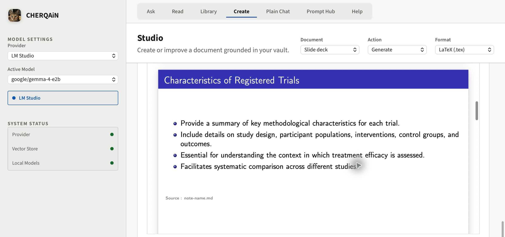<br>**Create** — a compiled local draft slide. The visible `note-name.md` source is a placeholder; the output has not received scientific acceptance. |
| 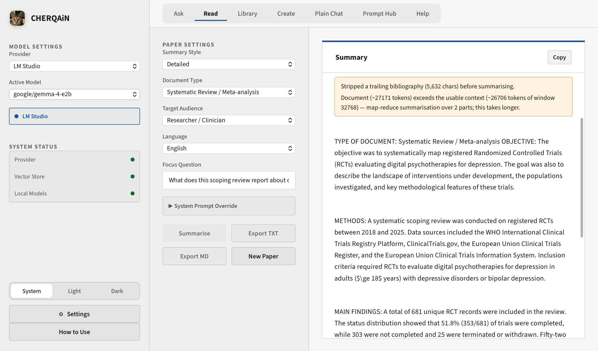<br>**Read** — an excerpt from a completed local summary. The full summary omitted important limitations. | 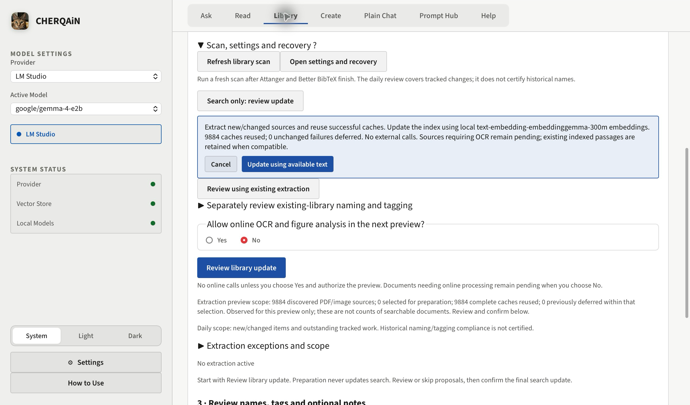<br>**Review search update** — a confirmation preview with cached-text reuse and online OCR disabled. Cache counts are not searchable-document counts. |

See the [screenshot notes](screenshots/blog-2026-10-28/README.md) for the capture context and limitations.

---

## Quickstart & Setup

### Prerequisites
- **macOS on Apple Silicon (`arm64`):** M1 or later with Xcode Command Line Tools (`xcode-select --install`).
- **Python 3.12:** Automatically installed via Homebrew by `install_and_build.sh` if absent.
- **Local Model Runner:** [Ollama](https://ollama.com) or [LM Studio](https://lmstudio.ai) (`http://localhost:1234`). Pull an embedding model (`nomic-embed-text` on Ollama by default) and a chat model.
- **Optional Online Providers:** Copy `.env.example` to `~/Library/Application Support/ChatEKLD/.env` (`chmod 600`) and set API keys (`OPENAI_API_KEY`, `ANTHROPIC_API_KEY`, `GOOGLE_API_KEY`, `DEEPSEEK_API_KEY`, `ZAI_API_KEY`, `OPENROUTER_API_KEY`, `TAVILY_API_KEY`, `ZOTERO_API_KEY`). Keys are never stored in `config.json`.

### Build or Run from Source

```bash
# 1. Build the macOS .app bundle and .dmg installer:
chmod +x install_and_build.sh
./install_and_build.sh
open CHERQAiN_$(date +%Y-%m-%d).app

# 2. Or run directly from a Python 3.12 virtual environment:
python3.12 -m venv ~/venvs/chatekld2026
source ~/venvs/chatekld2026/bin/activate
pip install --require-hashes -r requirements-lock-macos.txt
python launch.py

# 3. Optional CLI & MCP server registration:
python scripts/install_cli.py
python scripts/install_mcp.py
cherqain status
```

> [!TIP]
> **Sharing the `.dmg` with another Apple Silicon Mac:** Because the bundle is ad-hoc signed, remove the quarantine attribute once after dragging to `/Applications`:
> `xattr -dr com.apple.quarantine "/Applications/CHERQAiN_<date>.app"` and run `seed_models.command` once while online to pre-populate the HuggingFace reranker and tokenizer caches.

---

## System & Panel Architecture Graphs

### 1. Indexing Database & Hybrid Storage Architecture (`rag/`)

How Obsidian `.md` notes, `.pdf` papers, and note-referenced images are incrementally extracted, chunked, embedded locally, and persisted across `obsidian_storage/` and `obsidian_cache/`. Deep contract: [`rag/CLAUDE.md`](rag/CLAUDE.md).

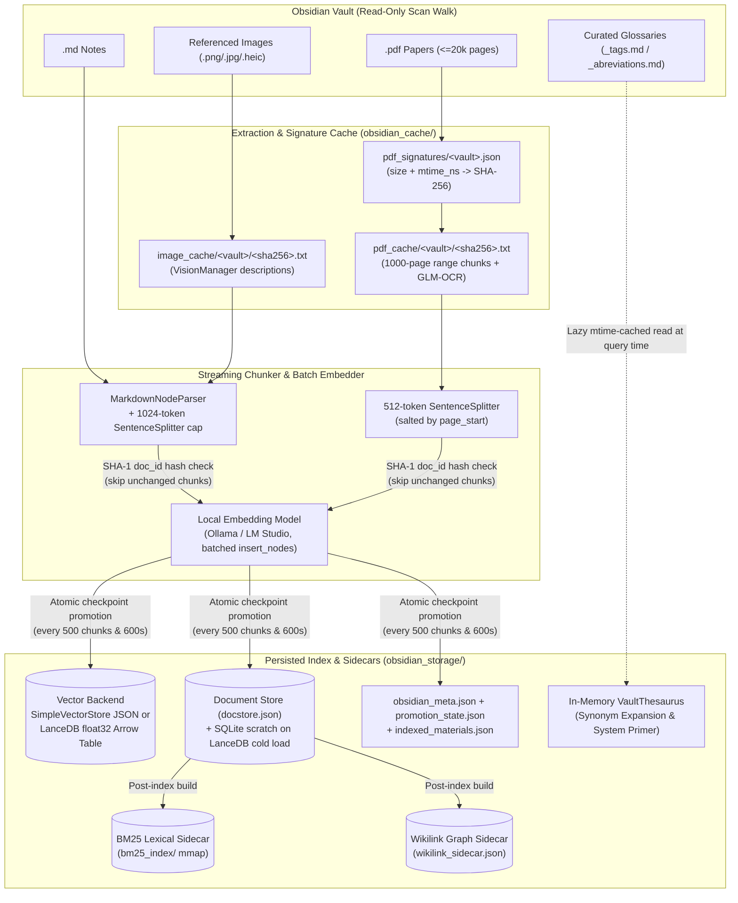

---

### 2. Panel 1 — `Ask` (Obsidian Vault Hybrid RAG & ReAct Agent)

Query-time retrieval and synthesis over the local index, supporting single-shot grounded Answer Modes and an opt-in multi-step ReAct agent loop. Deep contracts: [`rag/CLAUDE.md`](rag/CLAUDE.md), [`core/agent/CLAUDE.md`](core/agent/CLAUDE.md).

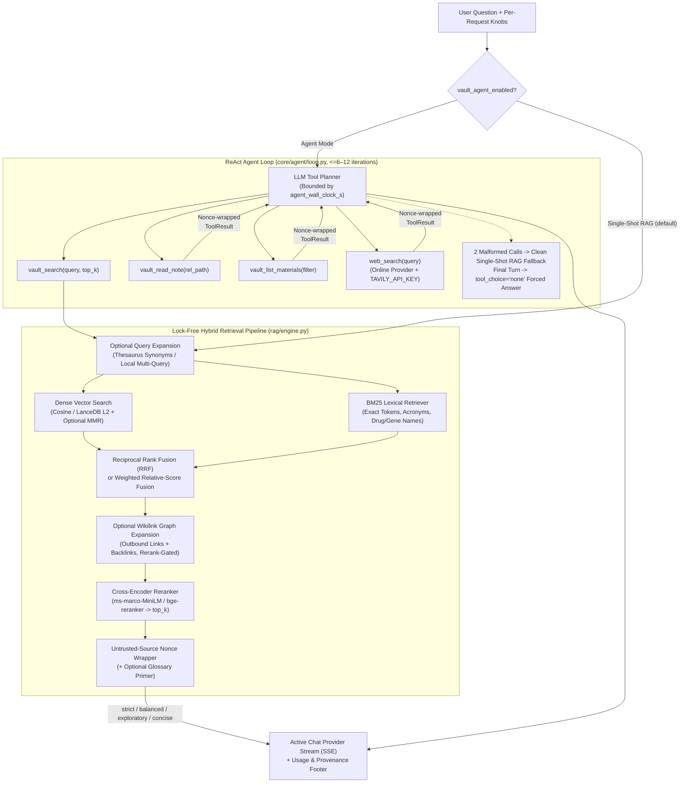

---

### 3. Panel 2 — `Read` (Single-Paper Summarisation)

Subprocess PDF text extraction, automatic bibliography stripping, and context-window-aware single-pass or map-reduce summarisation. Deep contract: [`services/README.md`](services/README.md).

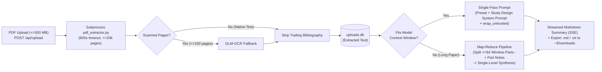

---

### 4. Panel 3 — `Library` (Audit, Daily Update, Tagging & Zotero Sync)

Manual cross-store observation (`audit/`), the 8-rung PDF-to-BibTeX Bridge, and confirm-gated, journalled writes across Obsidian notes, macOS Finder tags, and Zotero (`tagging/`, `accession/`, `notesync/`). Deep contracts: [`audit/CLAUDE.md`](audit/CLAUDE.md), [`tagging/README.md`](tagging/README.md), [`LIBRARY_WORKFLOWS.md`](LIBRARY_WORKFLOWS.md).

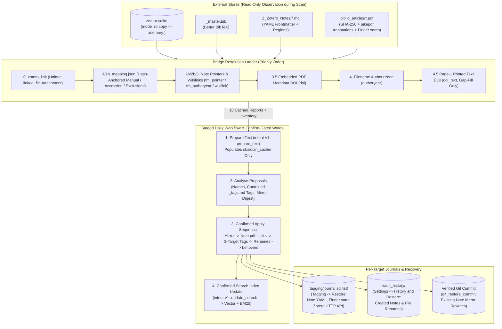

---

### 5. Panel 4 — `Create` (Studio: Beamer Decks, LaTeX Articles & Vault Markdown)

Grounded multi-section document generation and augmentation using your own `.tex` template preamble, macros, and `.bib` bibliography, with optional `latexmk` preview and auto-repair. Deep contracts: [`deckgen/README.md`](deckgen/README.md), [`docgen/README.md`](docgen/README.md).

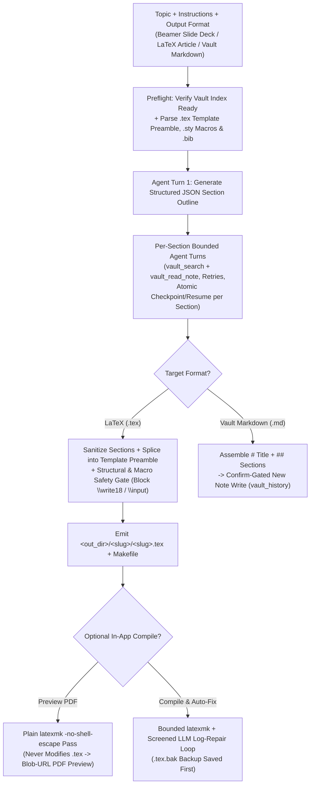

---

### 6. Panel 5 — `Plain Chat`, Multi-Provider Routing & Auxiliary Panels

Stateless multi-turn chat with server-side attachment extraction, unified across local and online LLM providers with pre-first-token fallback, cost tracking, and Prompt Hub inspection. Deep contracts: [`core/llm/CLAUDE.md`](core/llm/CLAUDE.md), [`services/README.md`](services/README.md), [`core/README.md`](core/README.md).

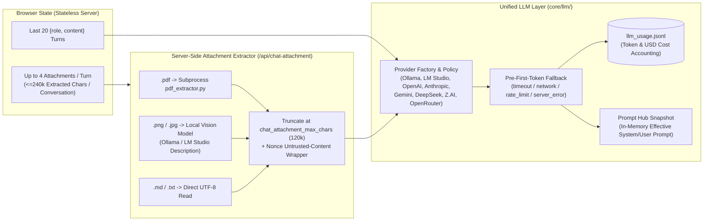

---

## Documentation Map

### User & Workflow Guides
| Guide | Scope |
| --- | --- |
| [In-App User Guide (`static/help/guide.md`)](static/help/guide.md) | Complete control-by-control walkthrough, recovery steps, and tips & limits. |
| [Library Workflows (`LIBRARY_WORKFLOWS.md`)](LIBRARY_WORKFLOWS.md) | Daily import → prepare text → review/apply proposals → update search sequence and recovery table. |
| [CLI & Agent Runbook (`CLI_GUIDE.md`)](CLI_GUIDE.md) | Headless `cherqain` CLI commands, MCP server tools, exit codes, and explicit online OCR scripts. |
| [Library Campaigns (`LIBRARY_CAMPAIGNS.md`)](LIBRARY_CAMPAIGNS.md) | Advanced bibliography verification, PDF authentication, storage control, and notesync campaigns. |
| [Desktop Widgets (`packaging/widgets/README.md`)](packaging/widgets/README.md) | SwiftBar menu-bar plugin and Übersicht desktop card setup (`widget.json`). |

### Subfolder Technical & Architecture References
| Package Document | Technical Scope |
| --- | --- |
| [`api/README.md`](api/README.md) | Complete `/api/*` endpoint inventory, SSE frame protocol, CSRF/origin guards, and concurrency limits. |
| [`core/README.md`](core/README.md) | Full `config.json` key reference, `CHERQAIN_BASE_DIR` disk layout, operation locks, and atomic writers. |
| [`rag/CLAUDE.md`](rag/CLAUDE.md) | Streaming vault indexer, `SimpleVectorStore` vs `LanceDB`, hybrid BM25+dense RRF, reranker, wikilink & thesaurus sidecars, and per-request chat overrides. |
| [`core/llm/CLAUDE.md`](core/llm/CLAUDE.md) | Local/online LLM adapters, context budgeting (`num_ctx` ladder), parameter healing, prompt caching, fallback policy, and USD cost tracking. |
| [`core/agent/CLAUDE.md`](core/agent/CLAUDE.md) | ReAct agent loop, tool schemas (`vault_search`, `vault_read_note`, `vault_list_materials`, `web_search`), deadlines, and forced final turns. |
| [`services/README.md`](services/README.md) | Single-Paper subprocess extraction, map-reduce summarization, Plain Chat attachment budgets, and GLM-OCR / Vision managers. |
| [`audit/CLAUDE.md`](audit/CLAUDE.md) | Vendored read-only Library Audit engine, the 18 report types, Bridge resolution rungs, and `zotero.sqlite` snapshot mechanics. |
| [`tagging/README.md`](tagging/README.md) | Biblio Tagging 3-target writers, Zotero Local/Web HTTP transports, keyless `accession/` lookup, `notesync/` mirror, and `vault_history/` journals. |
| [`deckgen/README.md`](deckgen/README.md) | Standalone and in-app Beamer slide deck orchestrator, template preamble splitting, and `latexmk` compile-fix loop. |
| [`docgen/README.md`](docgen/README.md) | Grounded LaTeX article/report and journalled Vault Markdown note/slide generation. |
| [`tests/eval/README.md`](tests/eval/README.md) | Answer-quality golden set and retrieval evaluation harness (`recall@k`, `MRR`, `nDCG@k`). |

### Project Governance & Verification
| Document | Scope |
| --- | --- |
| [`AGENTS.md`](AGENTS.md) / [`CLAUDE.md`](CLAUDE.md) | Root agent rules, data/write boundaries, and test commands (kept byte-identical). |
| [`PROJECT_REFERENCE.md`](PROJECT_REFERENCE.md) | Cross-cutting workflow, module hierarchy, security, and release verification contracts. |
| [`KNOWN_ISSUES.md`](KNOWN_ISSUES.md) | Open verification gates, dated measurements, and closed architectural decisions. |
| [`CHANGELOG.md`](CHANGELOG.md) | Chronological record of shipped features and fixes. |

---

## Development & Verification

Run focused checks from the Python 3.12 virtual environment:

```bash
python scripts/check_static_scope.py compile
ruff check .
python scripts/check_static_scope.py bandit
python scripts/check_mypy_ratchet.py
python -m pytest -q
npm ci
npm run test:js
PAPERMIND_PYTHON=python npm run test:browser
python scripts/check_dependency_audits.py
python scripts/check_docs.py
```

Public source releases are staged and verified without modifying the working tree via `python scripts/build_public_artifact.py`.

## License

MIT.
